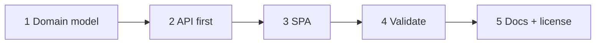
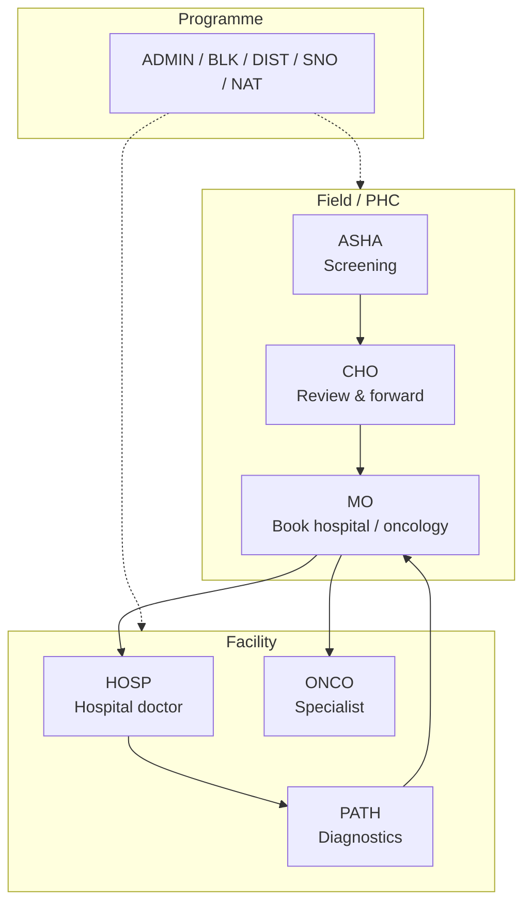
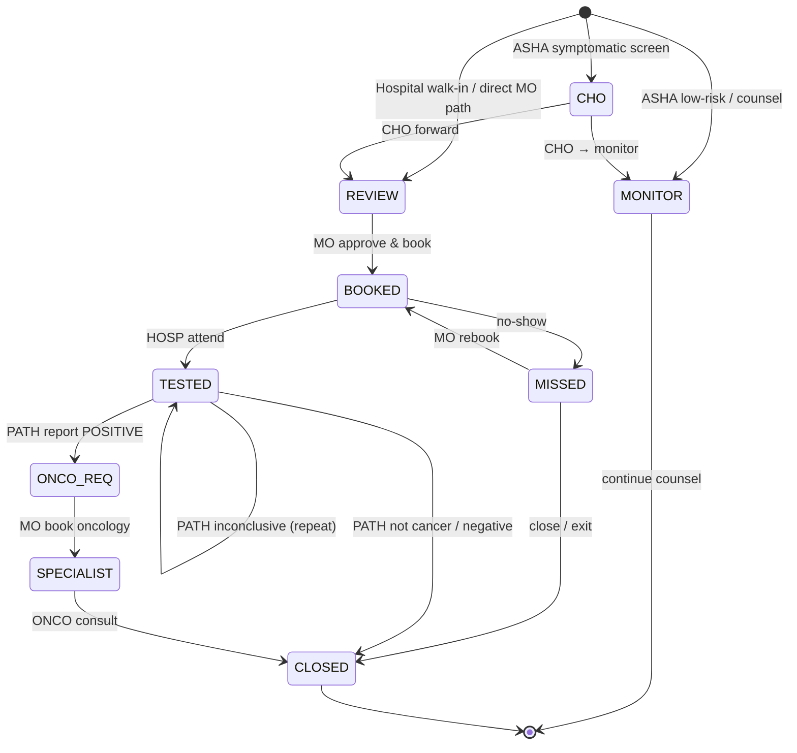
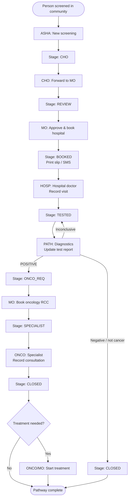
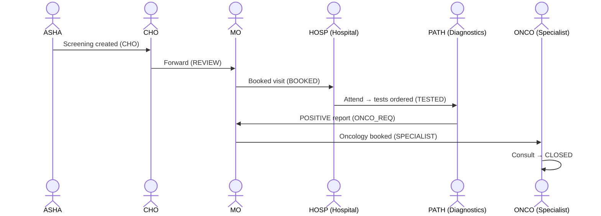
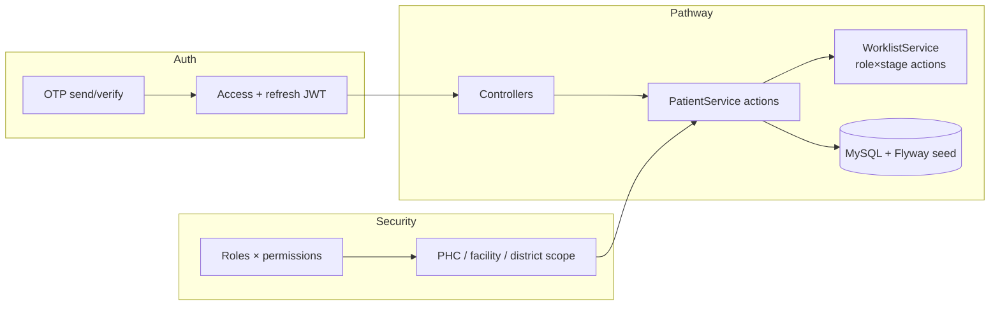
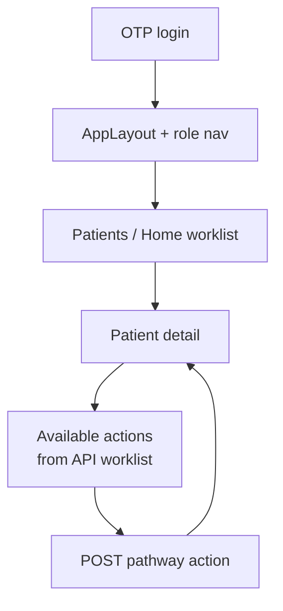
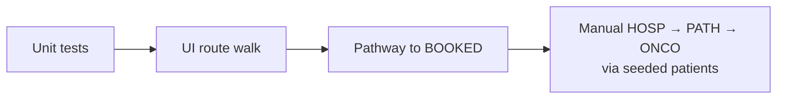

# Methodology and process for implementation

CARESETU was built as a layered referral system: **domain model first**, then **API**, then **role-aware SPA**, then **validation** and **docs**. The clinical flow does not stop at the hospital doctor — **Diagnostics (PATH)** and **Specialists (ONCO)** are first-class stages.

---

## 1. Implementation process

| Phase | What we did | Outcome |
|-------|-------------|---------|
| **1. Domain model** | Roles ASHA → CHO → MO → **HOSP** → **PATH** → **ONCO** (+ oversight ADMIN/BLK/DIST/SNO/NAT); patient stages `MONITOR … CLOSED` | Shared language for FE + BE |
| **2. API first** | OTP/JWT auth, RBAC + geographic scope, pathway actions, Flyway schema + demo seed | Stable `/api/v1` contract |
| **3. SPA** | React shell, role-gated nav, patient detail actions from backend worklist | Field and facility UIs |
| **4. Validate** | BE unit tests; headed UI walk; pathway ASHA → CHO → MO → BOOKED; manual seed cases for HOSP/PATH/ONCO | Working end-to-end demo |
| **5. Docs** | README, architecture, sample data/tests, methodology (this file), MIT license | Reproducible public repos |

---

## 2. Domain model — roles

| Role | Actor | Responsibility |
|------|-------|----------------|
| ASHA | Field worker | Create screening → stage **CHO** |
| CHO | Community Health Officer | Forward to MO → **REVIEW** |
| MO | Medical Officer | Book hospital → **BOOKED**; later book oncology → **SPECIALIST** |
| **HOSP** | **Hospital doctor** | Record visit / can’t serve → **TESTED** |
| **PATH** | **Diagnostics** | Enter test report → **ONCO_REQ** or **CLOSED** |
| **ONCO** | **Specialist** | Oncology consult → **CLOSED** / treatment start |
| ADMIN… | Oversight | Dashboard, map, audit, alerts |

---

## 3. Domain model — patient stages

---

## 4. End-to-end clinical flowchart (primary)

Use this diagram for submission slides / images.

### Compact one-liner (for slide bullets)

`ASHA screen → CHO → REVIEW → MO book → BOOKED → HOSP (hospital) → TESTED → PATH (diagnostics) → ONCO_REQ → MO oncology book → SPECIALIST → ONCO (specialist) → CLOSED`

---

## 5. Swimlane — who acts when

---

## 6. API-first process

- **Auth:** `/api/v1/auth/otp/*`, refresh, `/me`
- **Pathway:** create/screen, approve, refer/book, attend, report, oncology book, consult, rebook, exit, txstart
- **Seed:** Flyway `V1`–`V7` — demo users + patients parked at CHO, REVIEW, BOOKED, TESTED, ONCO_REQ, SPECIALIST, MISSED, CLOSED

---

## 7. SPA process

UI only shows actions the backend returns for **current role × stage** (e.g. PATH sees report only on **TESTED**; ONCO sees consult only on **SPECIALIST**).

---

## 8. Validation process

| Layer | Coverage |
|-------|----------|
| BE unit | `WorklistServiceTest` (e.g. HOSP attend on BOOKED; ASHA monitor) |
| FE headed walk | `npm run test:ui` — major routes |
| FE pathway | `npm run test:pathway` — ASHA → CHO → MO → **BOOKED** |
| Manual / seed | HOSP **CS-GNR-0003**; PATH **0005**; ONCO_REQ **0006**; ONCO **0007** |

---

## 9. Deliverables checklist

- [x] Working prototype (FE + BE)
- [x] Flowcharts (this document — Mermaid; export to PNG/SVG for slides if needed)
- [x] Architecture docs (`docs/ARCHITECTURE.md`)
- [x] Sample data & test cases (`docs/SAMPLE_DATA_AND_TESTS.md`)
- [x] README setup + MIT `LICENSE`
- [x] Public GitHub: [Caresetu-FE](https://github.com/Yash111801/Caresetu-FE) · [Caresetu-BE](https://github.com/Yash111801/Caresetu-BE)

### Exporting charts for PPT

GitHub renders Mermaid in this file. For PowerPoint: open this page on GitHub → copy diagrams, or paste Mermaid into [mermaid.live](https://mermaid.live) → Download PNG/SVG.
